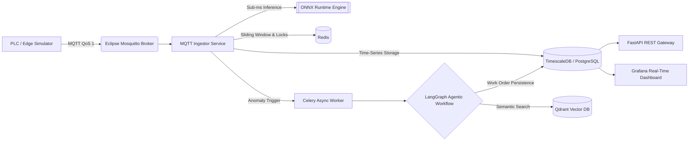

# IndusTwin AI: Event-Driven IIoT Predictive Maintenance & Agentic RAG Copilot


**IndusTwin AI** is an end-to-end, event-driven Industrial IoT (IIoT) platform designed for **real-time predictive maintenance** and **automated root-cause diagnostics using Agentic Retrieval-Augmented Generation (RAG)**.

Unlike traditional monitoring systems that rely on static single-variable thresholds, this platform ingests high-frequency multivariable sensor telemetry via **MQTT**, detects coupled electro-mechanical anomalies in **under 1 millisecond using ONNX Runtime**, and asynchronously dispatches an **AI Engineering Copilot (LangGraph + Qdrant)** via **Celery & Redis** to retrieve industrial Standard Operating Procedures (SOPs) and generate actionable LOTO (Lockout/Tagout) maintenance work orders.

---

## System Architecture



---

## Key Engineering Highlights & Design Decisions

### 1. Event-Driven IIoT Ingestion (MQTT vs. HTTP Polling)
Industrial plants with hundreds of PLCs and sensors cannot rely on synchronous HTTP requests due to TCP connection overhead. 
* **Solution:** Edge nodes publish lightweight JSON payloads over **MQTT (`Eclipse Mosquitto`, QoS 1)** on topic `planta/sensores/{sensor_id}/telemetria`.
* **In-Memory Sliding Windows:** The `mqtt_ingestor.py` service persists historical records into **TimescaleDB** while maintaining a real-time 10-reading sliding window per asset in **Redis RAM** (`LPUSH` + `LTRIM`).

### 2. Multivariable Anomaly Detection in `<1 ms` (ONNX Runtime)
Industrial rotating machinery (pumps, motors, compressors) rarely fails along a single isolated variable; degradation manifests as coupled physical phenomena.
* **Physical Variables Monitored:**
  * `voltaje` (V): Supply stability (nominal 24V DC / industrial bus).
  * `corriente` (A): Motor current draw (spikes indicate mechanical friction or overload).
  * `temperatura_c` (°C): Bearing housing thermal profile.
  * `vibracion_mm_s` (mm/s): RMS vibration velocity governed by **ISO 10816** standards (Zone D severe damage threshold $> 7.1\text{ mm/s}$).
* **MLOps Optimization:** An unsupervised pipeline (`StandardScaler` + `IsolationForest`) is trained on nominal operating regimes and exported to **ONNX** (`skl2onnx`). Inference runs on `CPUExecutionProvider` via **ONNX Runtime** with sub-millisecond latency, avoiding heavy ML framework overhead in production containers.

### 3. Asynchronous Agentic RAG & Distributed Debouncing (Celery + Redis + LangGraph + Qdrant)
Executing vector searches and LLM synthesis takes significantly longer than sensor ingestion intervals. Running AI agents synchronously inside the ingestion loop would cause message backpressure and data loss.
* **Redis Distributed Lock (Anti-Spam Debouncing):** When ONNX flags an anomaly, the ingestor acquires an atomic Redis lock (`SET cooldown_ia:{sensor_id} 1 NX EX 60`). This guarantees at most **1 diagnostic work order per minute per machine**, preventing alert storms.
* **Non-Blocking Execution:** Tasks are queued into **Redis** and consumed in the background by a dedicated **Celery Worker**.
* **LangGraph + Qdrant Workflow:**
  1. **`recuperador_rag` Node:** Converts the anomalous telemetry context into an embedding vector and queries **Qdrant** (Cosine similarity) to retrieve the most relevant industrial maintenance manual (SOPs, ISO 10816 guidelines, LOTO procedures).
  2. **`diagnosticador` Node:** Correlates the physical sensor readings with the retrieved technical manual (supporting **Google Gemini** via `langchain-google-genai` with an automatic deterministic engineering fallback) and persists a structured work order into **TimescaleDB**.

---

## Real-Time Observability (Grafana + TimescaleDB)

The platform includes a live **Grafana** workspace connected to **TimescaleDB** to monitor coupled electro-mechanical variables, ONNX anomaly severity scores, and AI-generated work orders in real time.

<!-- If you save your screenshot as dashboard_grafana.png in the root folder, uncomment the line below: -->
<!--  -->

---

## Tech Stack

| Layer | Technologies |
| :--- | :--- |
| **IIoT Protocol & Edge** | `Eclipse Mosquitto 2 (MQTT)`, `paho-mqtt`, Async Python Edge Simulator |
| **Backend & API Gateway** | `FastAPI`, `Pydantic v2`, `Uvicorn`, `SQLAlchemy 2.0` |
| **Machine Learning & Inference** | `Scikit-Learn` (`IsolationForest`), `ONNX`, `ONNX Runtime`, `skl2onnx`, `NumPy` |
| **Agentic AI & Vector Search** | `LangGraph`, `Qdrant Vector Database`, `LangChain`, `Google Gemini API` |
| **Async Task Queue & Cache** | `Celery`, `Redis 7` (Message Broker, Sliding Windows & Distributed Locks) |
| **Databases & Observability** | `TimescaleDB (PostgreSQL 16)`, `SQLite` (Test Isolation), `Grafana` |
| **DevOps & Quality Assurance** | `Docker`, `Docker Compose`, `pytest`, `GitHub Actions (CI/CD)` |

---

## Project Structure

```text
├── api.py                  # FastAPI REST Gateway & Pydantic v2 validation schemas
├── database.py             # SQLAlchemy 2.0 ORM models (Telemetry & AI Work Orders)
├── mqtt_ingestor.py        # MQTT subscriber, ONNX real-time evaluator & Redis/Celery trigger
├── train_onnx_model.py     # Unsupervised Isolation Forest training & ONNX exporter
├── ml_engine.py            # Sub-millisecond ONNX Runtime inference engine
├── agent_rag.py            # Qdrant Vector DB indexer & LangGraph multi-node workflow
├── celery_worker.py        # Background Celery worker for asynchronous RAG diagnostics
├── simulador.py            # Industrial PLC simulator (nominal operation + fault injection)
├── test_api.py             # Automated unit & integration test suite (pytest)
├── docker-compose.yml      # Multi-container orchestration (7 microservices)
├── Dockerfile              # Production Python container image definition
└── requirements.txt        # Pinned Python dependencies
```

---

## Quick Start (Docker Compose)

### Prerequisites
* **Docker** and **Docker Compose** installed on your machine.

### 1. Launch the Microservices Ecosystem
Clone the repository and spin up all 7 containers in detached mode:

```bash
git clone [https://github.com/Jomao03/api_telemetria.git](https://github.com/Jomao03/api_telemetria.git)
cd api_telemetria
docker compose up --build -d
```

### 2. Run the Industrial PLC Telemetry Simulator
Simulate real-time MQTT telemetry for `MOTOR_BOMBA_01` and `COMPRESOR_02` (automatically injects stochastic bearing degradation and thermal overload faults):

```bash
docker exec -it -e MQTT_BROKER=mosquitto servidor-iot python simulador.py
```

### 3. Monitor Real-Time Logs (MQTT + ONNX + Celery RAG)
Open another terminal to inspect the real-time anomaly detection and asynchronous AI work order generation:

```bash
# View MQTT ingestion and sub-millisecond ONNX alerts
docker logs industwin-mqtt-ingestor --tail 20 -f

# View Celery worker executing LangGraph + Qdrant RAG diagnostics
docker logs industwin-celery-worker --tail 20 -f
```

---

## API Endpoints & Services

Once the stack is running, access the following interfaces:

* **Interactive Swagger UI (OpenAPI):** [`http://localhost:8000/docs`](http://localhost:8000/docs)
* **Grafana Industrial Dashboard:** [`http://localhost:3000`](http://localhost:3000) (Credentials: `admin` / `admin`)
* **Qdrant Vector DB Web UI:** [`http://localhost:6333/dashboard`](http://localhost:6333/dashboard)

### Core REST Endpoints

| Method | Endpoint | Description |
| :--- | :--- | :--- |
| `GET` | `/health` | Container healthcheck endpoint for orchestrators. |
| `POST` | `/telemetria` | Ingests a multivariable sensor reading via HTTP and evaluates it with ONNX Runtime. |
| `GET` | `/telemetria/{sensor_id}` | Returns paginated historical telemetry (`voltaje`, `corriente`, `temperatura_c`, `vibracion_mm_s`, `score_anomalia`). |
| `GET` | `/analitica/{sensor_id}` | Computes real-time statistical aggregations (min, max, moving average) and threshold alerts. |
| `GET` | `/ordenes-ia/{sensor_id}` | Retrieves automated root-cause diagnostics and LOTO work orders generated by the **LangGraph + Qdrant** Copilot. |

#### Example Response: `GET /ordenes-ia/MOTOR_BOMBA_01`
```json
[
  {
    "id": 1,
    "sensor_id": "MOTOR_BOMBA_01",
    "timestamp": "2026-10-14T23:25:10.896000Z",
    "severidad": "CRÍTICA (ISO 10816 Zona D)",
    "causa_raiz": "Correlación multivariable detectada por ONNX (Score 12.19): Vibración severa (7.66 mm/s > límite 7.1 mm/s ISO 10816), sobrecorriente (10.03A) y elevación térmica (82.82°C). Referencia RAG: SOP-MEC-01: Falla en Rodamientos y Desalineación de Eje (Norma ISO 10816)...",
    "procedimiento_recomendado": "1) Aplicar protocolo LOTO (Lockout/Tagout) y desenergizar el circuito de 24V/480V. 2) Verificar alineación láser del eje. 3) Extraer rodamiento dañado con extractor hidráulico y reemplazar por serie SKF Explorer. 4) Relubricar con grasa de complejo de litio para alta temperatura."
  }
]
```

---

## Running Automated Tests (CI/CD)

The test suite (`test_api.py`) uses isolated temporary SQLite databases and FastAPI `TestClient` overrides to validate Pydantic boundaries, ONNX multivariable inference, statistical aggregations, and AI Copilot endpoints without mutating production data:

```bash
docker exec -it servidor-iot pytest -v
```

---

## Author

**Jonathan Mauricio Rojas Rodríguez**  
*Electronic Engineer | AI & Software Developer*  
* GitHub: [@Jomao03](https://github.com/Jomao03)
* Email: jomao1093@gmail.com